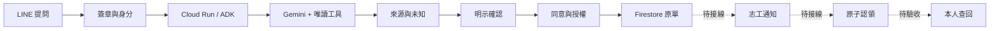
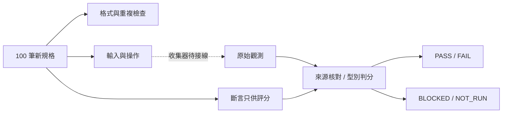
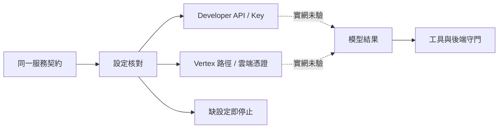

# LOCAL: one inquiry, separately accountable decisions

**Architecture source for the Day 29 review draft.** This is not proof that every connector has been deployed. The available implementation baseline is `a335fbc0b53e81a65d2a0f520c53b48cbc7055c3`; Day29 candidates are not part of that commit.

## Legend and scope

Solid arrows describe responsibility relationships found in existing designs or teaching modules. They do **not** mean this delivery independently exercised the whole deployed route. Dashed arrows indicate integration/acceptance still required. New evidence grading and model-access configuration are separate candidates.

| Area | Source / module family | Current evidence category |
|---|---|---|
| Entry, confirmation, original request | Days 11–13 | Existing implementation and earlier single-phone observations; not rerun here |
| Query, consented memory, untrusted content | Days 14–17, 25 | Existing code/design and case lineage; current100 collector not supplied |
| Evaluation | Day18 reference / Day29 candidate | Original20 retained;100 new specifications and42 grader/config tests |
| Stop control and claim | Days19,22,28 | Offline contracts; Firestore/phone integration not established by those contracts |
| Model access | Google Gen AI SDK | Configuration-factory tests only, no new model request |
| Monitoring | Day21 / Cloud Run | Structured-event mapping; no claim of Cloud Trace export |
| Day29 CI | Candidate YAML | Not pushed, not executed; no Run ID |

## Inquiry lifecycle

The lookup branch cannot create an approved service request. A confirmation must be validated against identity, operation content, authorization and current data. A volunteer action needs current service scope and stop/claim state. A data change and a phone notification have separate outcomes.

`operation_id` remains the internal original-request document key in the source adapter. `request_id` is the human-facing identifier stored in the row. Webhook event IDs, model tool-call IDs, notification retry keys and trace IDs retain their own roles and are correlated rather than substituted.

The proposed claim state is `pending_human_review -> human_claimed`, with a consistent `claim_version` and claimant. Existing readback validators/card builders must accept the legitimate new state while retaining owner/content bindings. This diagram is not evidence that such migration is finished.

## Fixture and observations

A collector receives `stimulus_for(case)`, not expected assertions. It must execute the selected real module, emulator or explicitly named simulator. The current package has no such full100 collector. Scoring unit tests intentionally use synthetic raw objects and are not service acceptance records.

The grader checks case/fixture/source/input/configuration bindings and raw-file integrity. A malicious producer could still fabricate consistent files; hashes are not source authentication. Audit the producer and retain original SDK outputs, backend snapshots and relevant device records.

## Model access boundary

The chapter preserves the historical Vertex AI route name. Current Google documentation uses Gemini Enterprise Agent Platform, and the Python SDK documents `vertexai` as a legacy flag for `enterprise`. The included candidate tests a factory interface, not a specific installed SDK version or successful provider connection. Pin SDK version and API version during integration; do not mix new model/access results with prior experimental numbers.

The same request contract does not imply equal model outputs, quotas, regions, timing or costs. VPC Service Controls, encryption and data-residency guarantees are feature/configuration-specific. Neither a region parameter nor a product name independently establishes compliance.

## Four acceptance readouts at the bottom of the final image

| Readout | Value for this delivery |
|---|---|
| Specifications / service observations | 100 specified / 0 observed; pass rate unknown |
| Complete two-phone workflow | NOT_RUN |
| Replay/idempotency subset | 16 specified / 0 observed; not additional cases |
| Day29 CI | candidate workflow only; no commit/run |

The 42 grader/config tests belong in a separate implementation-check box, not the100-service score. Performance radar, model latency and cost stay absent until evidence is supplied.

## Source references

- [Existing LOCAL source](https://github.com/jarsing/local-service-agent-for-line/tree/a335fbc0b53e81a65d2a0f520c53b48cbc7055c3)
- [ADK evaluations](https://adk.dev/evaluate/)
- [Google Gen AI SDK Client](https://googleapis.github.io/python-genai/genai.html)
- [Firestore transactions](https://firebase.google.com/docs/firestore/manage-data/transactions)
- [Cloud Run logging](https://docs.cloud.google.com/run/docs/logging)
- [LINE retries](https://developers.line.biz/en/docs/messaging-api/retrying-api-request/)
