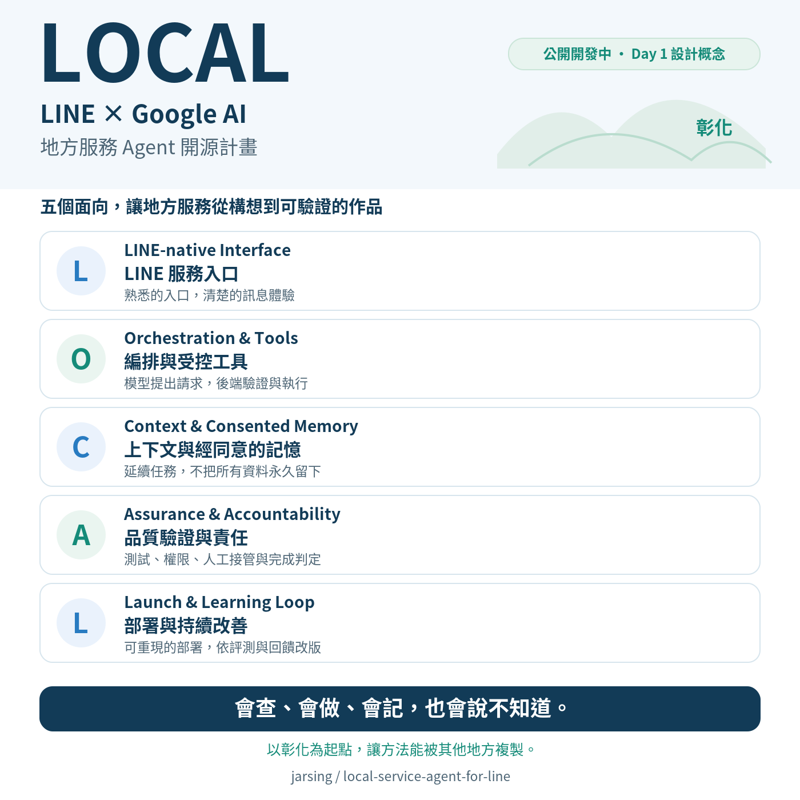

# LOCAL Agent Kit for LINE

[](https://github.com/jarsing/local-service-agent-for-line/actions/workflows/ci.yml)

> 在 LINE 裡問問題，讓 Gemini 搭配工具查資料，再把結果說清楚。

[English](README.md) · [iThome 連載](https://ithelp.ithome.com.tw/users/20120682/ironman/9872)

**系列：LOCAL：30 天打造 LINE × Google AI 地方服務 Agent**  
**作者：陳佳新（佳新哥）｜奇步應用｜GitHub：jarsing**



準備參加社區走讀，最先想知道的大概是：「幾點集合？在哪裡碰面？」要是同行者使用輪椅，還得確認整條路線是否方便通行。LOCAL 就從這些地方服務的小問題出發，逐步把 LINE、Gemini、查詢工具與後端流程接起來。

這份教材寫給已有 Web、HTTP API 或 LINE Bot 基礎，想開始使用 Google AI 的開發者。每個範例都有可以動手做的操作，以及值得一起拆解的設計選擇。

## 開源首頁產品卡（Product Card）

> 為地方長輩與志工設計，把 LINE 詢問、Google AI 理解與可查核的服務狀態串在一起。

- **三分鐘 Quickstart 一行指令：** 使用 Python 3.10+ 執行純本機離線範例。第一步完全不需 API 金鑰，不發送任何 LINE 訊息。
  ```bash
  python3 -m unittest test_day27_replay -v && python3 replay_day27.py --out out/day28/quickstart-01
  ```
- **觀察重點：** 單號唯一不重複、暫停狀態熔斷拒絕認領、恢復後由一位志工成功接手（`out/day28/quickstart-01/report.json`）。
- **進階探索：** Gemini 與 ADK 意圖分析、長輩飲食偏好授權記憶、Cloud Run 部署與 Firestore 持久化。雲端整合具備獨立憑證、費用與驗收關卡。
- **開源授權與治理：** MIT 開源授權（`LICENSE`）。貢獻指南：[`CONTRIBUTING.md`](CONTRIBUTING.md)。發布核對清單：[`docs/day28/RELEASE_CHECKLIST.md`](docs/day28/RELEASE_CHECKLIST.md)。

## 完賽導覽：我該從哪裡開始？

**30 天 iThome 鐵人賽連載已全數完賽（2026/10/14 · 完賽書籤標籤：[`ironman-2026-final`](https://github.com/jarsing/local-service-agent-for-line/releases/tag/ironman-2026-final)）。** 如果你是第一次來到這個專案，建議從 **[Day 1：第一條工程驗收規格](docs/day01/handoff-timeout-001.json)** 與 **[Day 2：純 Python 逾時與冪等實驗](examples/day02/README.md)** 出發，順著下方四個學習階段循序推進；或直接跳至下方的 [Day 1～30 連載與程式地圖](#連載與程式地圖)。

| 學習階段與定位 | 推薦起點（從第 1 天循序推進） | 核心體驗與學習重點 |
|---|---|---|
| **階段一：從第 1 天開始（Day 1–7）**<br>問題定義、規格與海報結構化 | **[Day 1：第一條驗收規格](docs/day01/handoff-timeout-001.json)**<br>**[Day 2：SQLite 與逾時重試](examples/day02/README.md)**<br>**[Day 5：ADK 活動搜尋](examples/day05/README.md)** | 為什麼「AI 說完成不等於完成」？從純 Python 逾時查回、Gemini API 初體驗、LINE Webhook 驗簽，到 ADK 工具呼叫、海報欄位抽取與人工複核。 |
| **階段二：確認、原單與記憶（Day 8–15）**<br>綁定操作、雲端部署與偏好記憶 | **[Day 8：操作指紋確認](examples/day08/README.md)**<br>**[Day 12：Cloud Run 部署](examples/day12/README.md)**<br>**[Day 14：經同意的記憶](examples/day14/README.md)** | 把「好」綁定具體 `operation_id`、SQLite／Firestore 冪等原單、離線 CI、Cloud Run 跨修訂版恢復、LINE Flex 舊卡防呆、長輩飲食偏好記憶與五層上下文預算。 |
| **階段三：防禦、評測與取捨（Day 16–23）**<br>最小特權、服務降級與成本帳本 | **[Day 16：不可信文件防禦](examples/day16/README.md)**<br>**[Day 18：20 題契約評測](examples/day18/README.md)**<br>**[Day 22：緊急停止開關](examples/day22/README.md)** | 防範傳單暗藏指令（唯讀白名單）、三種查不到與降級、20 題三層確定性評測、志工收件匣 CAS 認領、Decimal 成本帳本、Trace 缺陷定位、獨立停止閘門與 Google AI 選型矩陣。 |
| **階段四：觀測、重現與交接（Day 24–30）**<br>實測評測牆、乾淨容器與完賽對帳 | **[Day 24：三組分母評測牆](examples/day24/README.md)**<br>**[Day 27：Demo 與離線重放](examples/day27/README.md)**<br>**[Day 29：100 筆契約與架構總覽](examples/day29/README.md)**<br>**[Day 30：完賽回顧與總對帳](docs/day30/README.md)** | 真實模型路由與 A/B 成本核對、公開文字結構化採用、乾淨容器 155 項重現、三分鐘展示與 SQLite 離線重放、開源產品卡、100 筆規格評分器與 Day 30 完賽交接總對帳。 |

這份導覽完整收錄 30 天系列的規格與程式碼；完整文章請由 [iThome 系列頁](https://ithelp.ithome.com.tw/users/20120682/ironman/9872) 閱讀。Day 2～5 的指定案例採合成資料；Day 6 以操作者提供並註明來源的海報進行實驗。真實服務呼叫與執行結果皆在各篇文章中如實交代。

## 快速開始：先讓 Agent 查到集合資訊

在 GitHub Desktop 複製這個 Repo，或下載並解壓縮程式。接著在 **Repo 根目錄** 開啟終端機。以下指令適用 macOS／Linux，使用 Python 3.10 以上；Windows 的虛擬環境直譯器路徑為 `examples/day05/.venv/Scripts/python.exe`。

### 1. 準備 Day 5 環境並檢查介面

```bash
python3 -m venv examples/day05/.venv
examples/day05/.venv/bin/python -m pip install -r examples/day05/requirements.txt
examples/day05/.venv/bin/python -m pip check
examples/day05/.venv/bin/python examples/day05/verify.py --sdk
```

`verify.py` 檢查搜尋工具、報告與 LINE 路由；`--sdk` 再用真正的 ADK Runner 搭配腳本化模型，檢查工具往返。這一步採離線測試，接下來才使用 Gemini API。

Day 5 使用獨立虛擬環境，各日範例的相依套件分開管理。已建立相符環境的讀者可以直接沿用。

### 2. 執行一次真實活動查詢

先在自己的環境設定 `GEMINI_API_KEY`，或依 [Day 5 指南](examples/day05/README.md) 使用 Repo 外的私人金鑰檔。確認帳戶的用量與費用設定後，執行：

```bash
examples/day05/.venv/bin/python examples/day05/run.py --live \
  --case meeting --condition with_tool
```

這個入口使用預先準備的集合資訊問題，讓模型呼叫 `search_local_events(date, area, keyword)`。資料由 Python 工具讀取，ADK 將結果送回模型，再取得回答。

接著執行完整的小型比較：

```bash
examples/day05/.venv/bin/python examples/day05/run.py --live
```

完整批次是四題、兩組，共八個 Agent 回合，模型請求上限為十六次；前面的單題查詢是另外一個回合。兩組使用相同模型與主要生成設定，差別在能否透過工具取得活動資料。回答、事件、耗時與可取得的用量都會留下紀錄。

### 3. 打開報告，看它怎麼查

每次執行會印出本次報告位置，預設在 `output/day05/run-.../`：

| 檔案 | 用途 |
|---|---|
| `REPORT.html` | 在瀏覽器對照回答，展開工具請求、執行與回傳過程 |
| `COMPARISON.md` | 查看同一問題在有工具、無工具兩組的回答 |
| `verification.json` | 查看版本、輸入、原始文字、事件及用量 |

先找模型提出了哪些搜尋條件，再對照工具回傳的時間與地點。遇到缺少的無障礙欄位，看看模型怎麼說明那一項未知。報告中的答案以你的實際執行為準。

要把同一個 Agent 接進手機，接著看 [Day 5 的 LINE 介接操作](examples/day05/README.md)。它沿用 Day 4 的 Webhook，另外需要 LINE 測試頻道、私人設定與 HTTPS 入口；`LOCAL 測試` 目前觸發固定的無障礙查詢問題。

## 連載與程式地圖

以下按 Day 1 至 Day 30 的學習順序，完整列出全系列 30 篇已發表文章、對應程式或規格位置，以及每一章的核心實作重點：

| 日次 | 文章／主題 | 程式或規格 | 重現說明 | 核心實作與驗收重點 |
|---|---|---|---|---|
| Day 1 | [LOCAL：把地方服務需求變成 LINE × Google AI 的工程規格](https://ithelp.ithome.com.tw/articles/10411219) | [第一條驗收規格](docs/day01/handoff-timeout-001.json) | 以設計與驗收 JSON 為起點 | 地方服務問題定義、LOCAL 五大設計面向與 `handoff-timeout-001` 驗收契約 |
| Day 2 | [AI 說「完成」真的完成了嗎？把 LOCAL 的第一條驗收規格跑起來](https://ithelp.ithome.com.tw/articles/10412065) | [examples/day02](examples/day02/) | [docs/day02](docs/day02/README.md) | 同樣遇到逾時，後端卻可能已保存資料；重送時如何查回同一筆 |
| Day 3 | [從 AI Studio 到 Gemini API：建立 LOCAL 的第一個可重現模型實驗](https://ithelp.ithome.com.tw/articles/10412603) | [examples/day03](examples/day03/) | [docs/day03](docs/day03/README.md) | 固定輸入、模型原文、設定與用量 |
| Day 4 | [讓 Gemini 走進 LINE：先驗簽，再回覆，不把收到當完成](https://ithelp.ithome.com.tw/articles/10413146) | [examples/day04](examples/day04/) | [docs/day04](docs/day04/README.md) | 先用 `LOCAL ping` 確認往返，再用 `LOCAL 測試` 取得模型說明 |
| Day 5 | [ADK＋受控查詢：第一個 Agent 與 Orchestration](https://ithelp.ithome.com.tw/articles/10413779) | [examples/day05](examples/day05/) | [docs/day05](docs/day05/README.md) | 四筆活動、四個問題、兩組回答，以及工具的執行軌跡 |
| Day 6 | [從活動海報到服務資料](https://ithelp.ithome.com.tw/articles/10414133) | [examples/day06](examples/day06/) | [docs/day06](docs/day06/README.md) | 結構化欄位、原圖原文核對、人工審閱目錄匯出，並接回 Day 5 搜尋工具 |
| Day 7 | [看懂不等於可信：來源、版本與不知道](https://ithelp.ithome.com.tw/articles/10414804) | [examples/day07](examples/day07/) | [docs/day07](docs/day07/README.md) | 跨版本活動配對、欄位三元組差分、人工複核與三階段查詢介接 |
| Day 8 | [一句「好」不夠：確認綁定具體操作](https://ithelp.ithome.com.tw/articles/10415219) | [examples/day08](examples/day08/) | [docs/day08](docs/day08/README.md) | Google ADK Tool Confirmation、操作指紋核對、等待中換版阻斷與確認收據 |
| Day 9 | [按兩次送出，會不會多一筆？受控建單與冪等](https://ithelp.ithome.com.tw/articles/10415923) | [examples/day09](examples/day09/) | [docs/day09](docs/day09/README.md) | Google ADK `create_handoff_request`、SQLite 交易查重、同鍵同內容取原單與同鍵異內容衝突 |
| Day 10 | [逾時後到底有沒有送出？](https://ithelp.ithome.com.tw/articles/10416095) | [examples/day10](examples/day10/) | [docs/day10](docs/day10/README.md) | 唯讀 SQLite 查回對帳、合成傳輸故障注入、受控復原控制器，以及 GitHub Actions 離線 CI 工作流程 |
| Day 11 | [服務重啟了，剛才交代的事還在嗎？重送、背景工作與重啟恢復](https://ithelp.ithome.com.tw/articles/10416397) | [examples/day11](examples/day11/) | [docs/day11](docs/day11/README.md) | 雙後端儲存配接器（SQLite／Firestore 模擬器實測）、跨行程重啟恢復、租約式工作協調，以及離線測試套件 |
| Day 12 | [換了雲端容器，剛才交代的事還在嗎？第一個 Cloud Run 版本](https://ithelp.ithome.com.tw/articles/10417489) | [examples/day12](examples/day12/) | [docs/day12](docs/day12/README.md) | FastAPI Webhook 入口、Postback 二階段確認、Secret Manager 保險箱整合，以及跨修訂版讀回實測 |
| Day 13 | [按鈕還在，就代表還能按嗎？LINE Flex 的狀態與安全操作](https://ithelp.ithome.com.tw/articles/10417809) | [examples/day13](examples/day13/) | [docs/day13](docs/day13/README.md) | 固定 Flex 氣泡模板、Postback 動作綁定、舊卡取消防呆，以及純文字無障礙備援 |
| Day 14 | [「今天想吃素」不等於以後都要！經同意的記憶與地方店家查詢](https://ithelp.ithome.com.tw/articles/10418240) | [examples/day14](examples/day14/) | [docs/day14](docs/day14/README.md) | 第三項工具 `search_local_places`、彰化蔬食節店家資料、經同意偏好記憶生命週期與 Gemini 意圖分流 |
| Day 15 | [對話越來越長之後：Session、摘要與上下文預算](https://ithelp.ithome.com.tw/articles/10418768) | [examples/day15](examples/day15/) | [docs/day15](docs/day15/README.md) | 五層上下文架構、滑動視窗修剪、結構化話題摘要、偏好撤回脈絡失效與 `countTokens` 預算閘門 |
| Day 16 | [傳單裡偷藏指令，系統真的會照做嗎？不可信文件與最小權限](https://ithelp.ithome.com.tw/articles/10419112) | [examples/day16](examples/day16/) | [docs/day16](docs/day16/README.md) | 唯讀工具白名單、ADK `before_tool_callback` 攔截、後端執行核對與離線四個零驗證 |
| Day 17 | [查不到，是真的沒有，還是系統當下查不了？三種查不到與服務降級](https://ithelp.ithome.com.tw/articles/10419526) | [examples/day17](examples/day17/) | [docs/day17](docs/day17/README.md) | 有型別的結果（`no_data`／`query_unavailable`／`unsupported`）、非固定說法意圖分流、固定文案與按鈕引導，以及離線故障注入驗證 |
| Day 18 | [20 題地方契約評測：從問句、工具到回覆，連失敗一起留下](https://ithelp.ithome.com.tw/articles/10419979) | [examples/day18](examples/day18/) | [eval/local20.json](eval/local20.json) | 20 題地方契約基準（`eval/local20.json`）、三層確定性判分器、雙軌隔離評測、請求節奏閘門與 28 項反例攔截 |
| Day 19 | [志工真的接到單了嗎？最小真人通知與收件匣閉環](https://ithelp.ithome.com.tw/articles/10420229) | [examples/day19](examples/day19/) | [docs/day19](docs/day19/README.md) | 志工收件匣契約、CAS 樂觀鎖原子認領、收件匣完整歷程與逾時查回對帳（雙視窗驗收規格見 Day 26） |
| Day 20 | [模型設定、延遲與每項任務成本：品質先過關，再談快與省](https://ithelp.ithome.com.tw/articles/10420729) | [examples/day20](examples/day20/) | [docs/day20](docs/day20/README.md) | 來源明確的成本帳本（`cost_ledger.py`）、Decimal 牌價算術、思考 Token 獨立計價與 2 秒回應門檻隔離 |
| Day 21 | [一條 Trace 找到問題：從模型工具呼叫一路追到後端結果](https://ithelp.ithome.com.tw/articles/10421328) | [examples/day21](examples/day21/) | [docs/day21](docs/day21/README.md) | 結構化追蹤核對器（`trace_audit.py`）、Cloud Logging 結構化日誌映射、多層缺陷診斷體系與 PII 邊界防護 |
| Day 22 | [權限、秘密與停止開關：最小特權與緊急制動](https://ithelp.ithome.com.tw/articles/10421645) | [examples/day22](examples/day22/) | [docs/day22](docs/day22/README.md) | 獨立停止閘門（`circuit_breaker.py`）、epoch 准入失效控制、原子建單與 outbox 意圖、三權分立目標架構規劃、專用 CI 測試套件 |
| Day 23 | [選型判斷表：Google AI 工具箱在地方服務該怎麼選？](https://ithelp.ithome.com.tw/articles/10421985) | [examples/day23](examples/day23/) | [docs/day23](docs/day23/README.md) | 離線選型決策篩選器（`stack_matrix.py`）、四套架構設計宣告（AI Studio、Vertex AI、Cloud Run、Firestore）、本機行程探針、專用 CI 測試套件 |
| Day 24 | [改了一行，20 題還過嗎？Google AI 實測牆與 A/B 成本量測](https://ithelp.ithome.com.tw/articles/10422261) | [examples/day24](examples/day24/) | [docs/day24](docs/day24/README.md) | 直接 SDK 路由擷取（`capture.py`）、證據核對器（`audit.py`）、20 題地方契約回歸執行器（`offline.py`）、離線重播驗證（`replay.py`）、專用 CI 測試套件 |
| Day 25 | [Gemini 結構化輸出抽取地方資料：從公開文字到服務資料庫](https://ithelp.ithome.com.tw/articles/10422718) | [examples/day25](examples/day25/) | [docs/day25](docs/day25/README.md) | Gemini 結構化輸出入口（`capture.py`）、確定性原文核對契約（`schema.py`）、審閱採用儲存庫（`store.py`）、五題實測與審閱執行器（`run_live.py`）、專用 CI 測試套件 |
| Day 26 | [走出自己房間之前：乾淨環境與雙 LINE 視窗的驗收規格](https://ithelp.ithome.com.tw/articles/10423179) | [examples/day26](examples/day26/) | [docs/day26](docs/day26/README.md) | 乾淨容器重現腳本（`cleanroom.sh`）、Google Cloud Shell 專用 Dockerfile、155 項完整測試離線驗證、雙 LINE 視窗生命週期時序規格，以及 SQLite CAS 原子認領 |
| Day 27 | [成果展示要鎖住什麼？Demo 版本凍結、三分鐘劇本與離線備援](https://ithelp.ithome.com.tw/articles/10423364) | [examples/day27](examples/day27/) | [docs/day27](docs/day27/README.md) | 三分鐘展示手冊（`DEMO.md`）、Google Cloud Shell 乾淨容器驗收腳本（`cleanroom.sh`）、本機 SQLite 離線重放示範（`replay_day27.py`），以及 5 項獨立單元測試 |
| Day 28 | [把 LOCAL 交給開發者：產品卡、Quickstart 與開源交付規格](https://ithelp.ithome.com.tw/articles/10423648) | [examples/day28](examples/day28/) | [docs/day28](docs/day28/README.md) | 中英文首頁產品卡、三分鐘 Quickstart 一行離線驗證、Cloud Run 404 路由排查範例、Firestore CAS 認領契約、MIT 授權與 CONTRIBUTING 指南 |
| Day 29 | [100 筆地方契約評測大驗收與完整流程架構總覽](https://ithelp.ithome.com.tw/articles/10423875) | [examples/day29](examples/day29/) | [docs/day29](docs/day29/README.md) | 100 筆五大場景契約規格、四態離線評分器（42 項測試全過）、一則地方詢問的一生完整流程架構總覽、模型抽象閘道雙軌設計 |
| Day 30 | [從規格到可交接的 LOCAL：30 天回顧、工程取捨與下一步](https://ithelp.ithome.com.tw/articles/10424210) | [eval/local100.json](eval/local100.json) · [ARCHITECTURE.md](ARCHITECTURE.md) | [docs/day30](docs/day30/README.md) | 30 天四大架構階層演進總整理、全系列承諾對帳、三組分母實測盤點、企業級 Sub-Agent 擴充藍圖與 [`ironman-2026-final`](https://github.com/jarsing/local-service-agent-for-line/releases/tag/ironman-2026-final) 完賽交接 |

Day 1 交付的是初始設計與驗收規格，因此可執行程式範例從 `examples/day02/` 開始。

這是一個循序演進 30 天的完整 LOCAL 專案，各日資料夾保留當章的教學重點：地方服務請求、冪等重試、逾時查回對帳、任務狀態持久化／跨行程重啟恢復、部署至 Cloud Run 搭配 Firestore 的雲端版本、LINE Flex 氣泡卡片防禦、經同意的飲食偏好記憶與地方店家查詢、五層上下文工程與 Session 預算管理、不可信文件防禦與唯讀權限白名單、有型別的結果與服務降級、20 題地方契約評測基準與三層確定性驗收、志工收件匣契約與 CAS 樂觀鎖、模型設定／延遲／成本帳本與比較條件核對、結構化追蹤核對與 Cloud Logging 映射、受控停止閘門與最小特權身分分工、架構決策矩陣、三組分母評測牆與 A/B 成本量測、公開文字結構化抽取管線與 SQLite 採用收據、乾淨容器環境重現與雙 LINE 視窗生命週期驗收規格、展示版本凍結手冊與本機離線 SQLite 重放備援、開源產品卡與交付規格、100 筆合成契約規格與四態離線評分器，以及 Day 30 的全系列回顧、承諾對帳與交接手冊。

## LINE、Gemini 與 ADK 各做什麼？

以 Day 5 的 LINE 示範來看：

**LINE 固定指令 → Webhook → Gemini 提出查詢 → Python 工具查活動 → ADK 傳回結果 → Gemini 整理文字 → LINE 回覆。**

LINE 提供訊息入口；Gemini 理解問題並提出工具呼叫；ADK 串起模型、工具與事件。Python 工具負責實際讀取活動資料。Google AI Studio 是 Gemini API 金鑰的取得與管理入口；Google Antigravity 則用在本專案的開發協作。

回顧全系列 30 天的整合脈絡：Day 12 加入 Cloud Run 的 LINE 教學服務；Day 14 落地經同意的偏好記憶與店家查詢；Day 17 落地有型別的結果與服務降級；Day 18 建立 20 題地方契約評測與三層確定性驗收；Day 19 建立志工收件匣契約；Day 20 實現成本帳本計算；Day 21 落地結構化追蹤核對與 Cloud Logging 映射；Day 22 交付受控停止閘門與最小特權分工；Day 23 建立架構決策矩陣；Day 24 交付三組分母實測評測牆與核對器；Day 25 交付公開文字結構化抽取與 SQLite 審閱採用儲存；Day 26～27 交付乾淨環境重現、雙 LINE 視窗驗收規格與離線重放備援；Day 28～30 則完成開源產品卡、100 筆契約評分器、完整架構總覽與最終完賽交接對帳。

## LOCAL 的五個設計面向

| 字母 | 設計面向 | 關心的問題 |
|---|---|---|
| L | LINE-native Interface | 使用者如何提問、看懂結果與繼續操作？ |
| O | Orchestration & Tools | 模型、工具與後端怎麼分工？ |
| C | Context & Consented Memory | 對話需要哪些資訊，哪些偏好經同意後保存？ |
| A | Assurance & Accountability | 用什麼證據確認結果，誰負責下一步？ |
| L | Launch & Learning Loop | 如何部署、觀察問題，再改善下一版？ |

五個面向共同支持同一套服務，會隨實作彼此交織。

## 一起試試看

歡迎從一個範例開始，記下你照著操作時卡住的地方，再到對應文章留言，或在本 Repo 提出 Issue。回報時附上日次、程式版本與錯誤訊息，並遮蔽 API 金鑰及使用者資料，方便一起找到原因。

**你會先把哪一種地方服務查詢交給工具？**

## 授權條款

本專案程式碼採用 MIT 授權條款釋出，完整授權內容請參閱 [LICENSE](LICENSE) 檔案。測試與範例請使用合成資料或經明確授權之資料，切勿公開個人機敏資訊、正式 LINE 憑證或金鑰。
